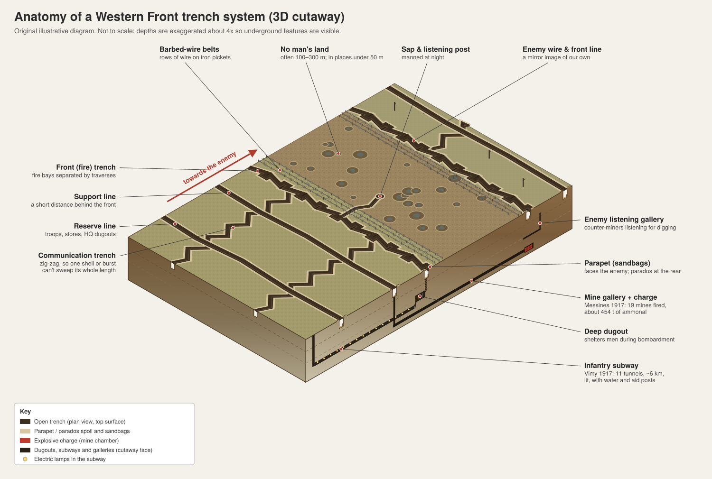
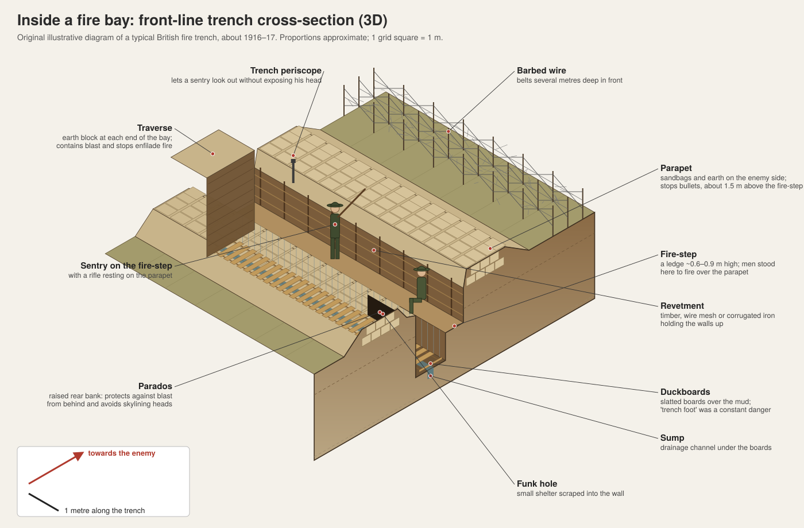
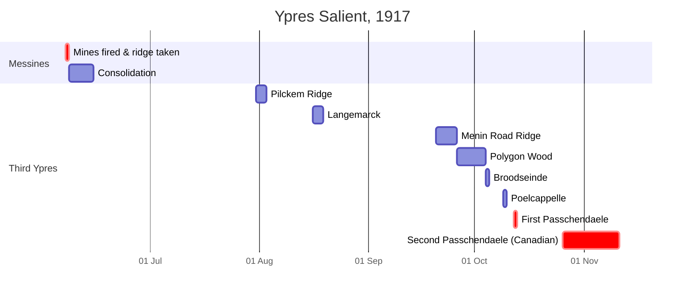
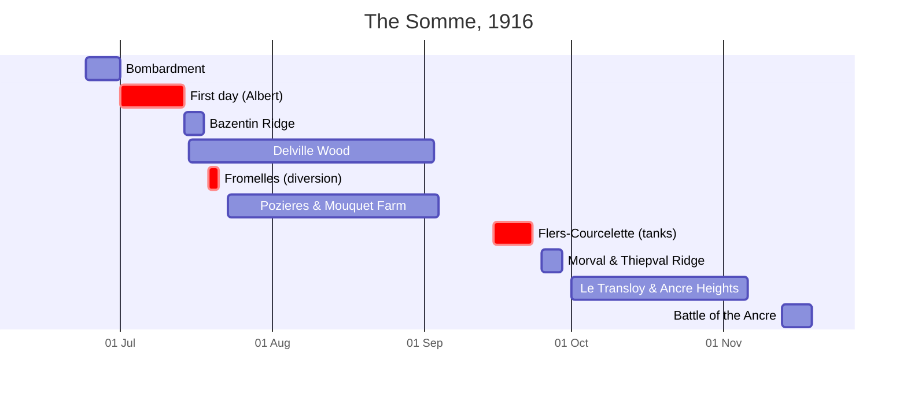

# The Three Best-Documented Battlefields of WWI Trench Warfare

### Ypres Salient (Messines & Passchendaele) · The Somme · Vimy Ridge

A visual field guide to the most thoroughly mapped, photographed and recorded trench battlefields of the Western Front. It covers trench maps, 3D cutaways of the trench systems, how each battle unfolded, the weapons and vehicles used, and the uniforms worn on both sides.

> **About the images:** The two 3D diagrams in `images/` are original illustrations made for this guide. Every other picture loads from **Wikimedia Commons**, so you need an internet connection to see them. Each caption links to the image's Commons page, which gives its full description, date, photographer and licence. Most wartime photographs are public domain (for example, Imperial War Museum Crown-copyright photos, Library and Archives Canada and the Australian War Memorial). Some modern museum photos are CC BY-SA and need attribution if you republish them.

---

## Contents

1. [Why these three battlefields?](#1-why-these-three-battlefields)
2. [Anatomy of a trench system (3D)](#2-anatomy-of-a-trench-system-3d)
3. [Battlefield 1: The Ypres Salient (Messines & Passchendaele, 1917)](#3-battlefield-1--the-ypres-salient-messines--passchendaele-1917)
4. [Battlefield 2: The Somme (1916)](#4-battlefield-2--the-somme-1916)
5. [Battlefield 3: Vimy Ridge (April 1917)](#5-battlefield-3--vimy-ridge-april-1917)
6. [Weapons](#6-weapons)
7. [Vehicles, artillery transport & aircraft](#7-vehicles-artillery-transport--aircraft)
8. [Uniforms & helmets](#8-uniforms--helmets)
9. [Explore the original maps & the ground today (including 3D)](#9-explore-the-original-maps--the-ground-today-including-3d)
10. [Sources](#10-sources)

---

## 1. Why these three battlefields?

| | **Ypres Salient** | **The Somme** | **Vimy Ridge** |
|---|---|---|---|
| **Where** | West Flanders, Belgium | Picardy, northern France | Artois, near Arras, France |
| **Key fighting** | Messines (7–14 Jun 1917); Third Ypres / Passchendaele (31 Jul–10 Nov 1917) | 1 Jul–18 Nov 1916 (141 days) | 9–12 Apr 1917 |
| **Main armies** | British, Australian, New Zealand, Canadian, French vs German | British Empire & French vs German | Canadian Corps (with British support) vs German |
| **Why it's so well documented** | Fought over for all four years, so it was surveyed and resurveyed constantly. Trench maps were corrected week by week, with barrage maps and mine plans for every attack. | Huge numbers of war diaries, official photographs, aerial photos and the first-ever feature-length battle film. Nearly every wood and village has its own detailed map. | Planned in exceptional detail: maps went down to junior NCOs, troops rehearsed on taped-out courses and scale models, and the tunnels and trenches are still preserved on site. |

The British alone printed an estimated **34 million maps** of Belgium and France during the war. The three battlefields above have the densest surviving coverage of those maps, along with aerial photographs and written records.

 The Western Front in 1917. The red line marks the front on 5 April 1917, days before Vimy Ridge. Ypres is at the top left, Arras/Vimy in the centre and the Somme below it. · <a href="https://commons.wikimedia.org/wiki/File:Western_Front_1917.jpg">Wikimedia Commons</a>

---

## 2. Anatomy of a trench system (3D)

Trench systems on the Western Front were not single ditches. They were networks several kilometres deep, made up of a **front (fire) line**, a **support line** and a **reserve line**, joined by zig-zagging **communication trenches**. Underground there were **dugouts**, **infantry subways** and offensive **mine galleries**.

 <b>Original 3D cutaway</b> (vector version: <a href="images/trench-system-3d.svg">trench-system-3d.svg</a>). The right-hand face is cut away to show a deep dugout, a Vimy-style infantry subway and a Messines-style mine gallery running under no man's land.

 <b>Original 3D cross-section of one fire bay</b> (vector version: <a href="images/fire-trench-section-3d.svg">fire-trench-section-3d.svg</a>).

### Key features

| Feature | What it was for |
|---|---|
| **Fire bays & traverses** | The front trench was dug in a "crenellated" pattern: straight bays separated by blocks of earth (traverses). A shell or an enemy who got into one bay could only affect that bay. |
| **Parapet / parados** | Sandbagged banks in front (parapet) and behind (parados). The parados stopped men from being silhouetted and caught blast from shells landing behind. |
| **Fire-step** | A ledge that let a soldier stand high enough to see and shoot over the parapet. |
| **Duckboards & sump** | Slatted wooden walkways over a drainage channel. Flanders in particular sits on waterlogged clay. |
| **Revetment** | Timber, wire mesh, corrugated iron or wattle holding the walls up. |
| **Communication trench** | Zig-zagged so that one shell or one machine gun could not rake its whole length. Used to bring up men, food, ammunition and the wounded. |
| **Saps & listening posts** | Short trenches pushed into no man's land, manned at night to listen for raids or wiring parties. |
| **Dugouts** | British dugouts were often shallow. German dugouts on the Somme were dug deep into the chalk, sometimes more than 10 m down, which is why many defenders survived the week-long British bombardment. |
| **Pillboxes** | By 1917 the Germans in Flanders relied on concrete pillboxes in a deep, flexible "defence in depth" rather than a single strong trench line. |
| **Tunnels & mines** | Tunnellers dug galleries under no man's land and packed them with explosives (Messines, Somme), or dug "subways" to move troops safely to the front (Vimy). |

Real examples:

<table>
<tr>
<td width="50%" align="center" valign="top"> A 1914 instruction diagram for building a revetted fire trench with bays and traverses (from <i>Field Entrenchments</i>, 1914) · <a href="https://commons.wikimedia.org/wiki/File:Trench_construction_diagram_1914.png">Commons</a></td>
<td width="50%" align="center" valign="top"> Aerial photograph of real trench systems near Loos–Hulluch, July 1917. Note the crenellated fire trenches and zig-zag communication trenches · <a href="https://commons.wikimedia.org/wiki/File:Aerial_view_Loos-Hulluch_trench_system_July_1917.jpg">Commons</a></td>
</tr>
</table>

<table>
<tr>
<td width="50%" align="center" valign="top"> British sentry on a fire-step while comrades sleep, Cheshire Regiment trench near La Boisselle, Somme, July 1916 · <a href="https://commons.wikimedia.org/wiki/File:Cheshire_Regiment_trench_Somme_1916.jpg">Commons</a></td>
<td width="50%" align="center" valign="top"> A 1:10,000 British trench map reproducing details from a captured German map, Ypres, September 1917 · <a href="https://commons.wikimedia.org/wiki/File:Reproduction_of_captured_German_trench_map_(20_Sept_1917).jpg">Commons</a></td>
</tr>
</table>

---

## 3. Battlefield 1: The Ypres Salient (Messines & Passchendaele, 1917)

**Ypres** (now Ieper) was the only Belgian city of any size that stayed in Allied hands. The low ridges curving around it to the south and east were held by the Germans, so the British-held ground formed a "salient" (a bulge) overlooked on three sides. Major battles were fought here in 1914, 1915 (where poison gas was first used on a large scale in April 1915), 1917 and 1918. That made it one of the most intensively surveyed patches of ground in the war.

### Maps

 The British front line and the German defensive belts east of Ypres, mid-1917, the system that Third Ypres had to break through · <a href="https://commons.wikimedia.org/wiki/File:German_defences_east_of_Ypres_mid-1917.jpg">Wikimedia Commons</a>

<table>
<tr>
<td width="50%" align="center" valign="top"> Battle of Messines: the front on 7 June 1917 and the advance to 14 June · <a href="https://commons.wikimedia.org/wiki/File:Battle_of_Messines_-_Map.jpg">Commons</a></td>
<td width="50%" align="center" valign="top"> An original Messines mine plan, showing the galleries under Hollandscheschuur Farm · <a href="https://commons.wikimedia.org/wiki/File:Battle_of_Messines_1917_mine_plan_-_Hollandscheschur_Farm.jpg">Commons</a></td>
</tr>
</table>

<table>
<tr>
<td width="50%" align="center" valign="top"> 1:10,000 artillery barrage map for the First Battle of Passchendaele, 12 October 1917 (Australian War Memorial) · <a href="https://commons.wikimedia.org/wiki/File:First_Battle_of_Passchendaele_-_barrage_map.jpg">Commons</a></td>
<td width="50%" align="center" valign="top"> The front line after Poelcappelle and First Passchendaele, 9–12 October 1917 · <a href="https://commons.wikimedia.org/wiki/File:Front_line_after_Poelcapelle_and_1st_Passchendaele_9-12_October_1917.jpg">Commons</a></td>
</tr>
</table>

<table>
<tr>
<td width="50%" align="center" valign="top"> The Canadian sector at Second Passchendaele, 26 October–10 November 1917 · <a href="https://commons.wikimedia.org/wiki/File:Second_Battle_of_Passchendaele_map_-_Canadian_sector_-_26_October_-_10_November_1917.jpg">Commons</a></td>
<td width="50%" align="center" valign="top"> Canadian Corps barrage map for the first stage, 26 October 1917. Each line is the timed "lift" of the creeping barrage · <a href="https://commons.wikimedia.org/wiki/File:Second_Battle_of_Passchendaele_-_First_Stage_(October_26)_Barrage_Map.jpg">Commons</a></td>
</tr>
</table>

 A German trench map of the Passchendaele area (German trenches overprinted in blue on a grey base map, scale 1:20,000), early October 1917 · <a href="https://commons.wikimedia.org/wiki/File:Second_Battle_of_Passchendaele_-_German_Trench_Map.jpg">Wikimedia Commons</a>

### How it unfolded

#### Messines Ridge, 7–14 June 1917

The aim was to take the Messines–Wytschaete ridge south of Ypres, which flattened out a German bulge in the line and secured the right flank for the main offensive.

- **Preparation:** Tunnellers (British, Canadian, Australian and New Zealand) had secretly dug galleries under the German front line for many months. The **1st Australian Tunnelling Company** took over the oldest mines, at **Hill 60**, in November 1916. Troops studied large ground models of the ridge.
- **7 June, ~03:10:** **19 mines** containing about **454 tonnes of ammonal** went off almost at once. It was one of the largest man-made explosions before the nuclear age, and the blast was reportedly felt in England. The biggest charges were St Eloi (about 43 t) and Spanbroekmolen (about 41 t), which left today's "Lone Tree" crater, now the **Pool of Peace**.
- **The assault:** Infantry, including the 3rd and 4th Australian Divisions and the New Zealand Division (which took Messines village), advanced behind a creeping barrage. The whole ridge was taken within about **three hours**.
- **Cost:** The two Australian divisions alone had nearly **6,800** casualties, mostly from German shelling on the newly captured ground.
- **Postscript:** Some mines were never fired. One of them exploded during a thunderstorm in **1955**, and at least one more is believed to still lie under the fields.

<table>
<tr>
<td width="50%" align="center" valign="top"> The Spanbroekmolen ("Lone Tree") mine crater today, now the Pool of Peace · <a href="https://commons.wikimedia.org/wiki/File:Lone_Tree_Crater_2009.jpg">Commons</a></td>
<td width="50%" align="center" valign="top"> The 1917 deep-mine crater at Hill 60, south-east of Ypres · <a href="https://commons.wikimedia.org/wiki/File:Hill_60_Ypres_Belgium_14_-_1917_deep_mine_crater_Hill_60.JPG">Commons</a></td>
</tr>
</table>

#### Third Ypres / Passchendaele, 31 July–10 November 1917

| Phase | Dates | What happened |
|---|---|---|
| **Pilckem Ridge** | 31 Jul–2 Aug | The British Fifth Army (Gough) attacked before dawn and gained ground in the north. German counter-attacks drove them back on the Gheluvelt Plateau. Heavy rain began almost at once. |
| **Langemarck** | 16–18 Aug | Gains were made around Langemarck and St Julien, but attacks further south failed. Haig paused the offensive in bad weather. |
| **Menin Road Ridge** | 20–25 Sep | Plumer (Second Army) took over, using short "bite-and-hold" advances under huge artillery support and more aircraft. Most objectives were taken and held. |
| **Polygon Wood** | 26 Sep–3 Oct | The 5th Australian Division fought at Polygon Wood and Black Watch Corner. German counter-attacks failed again. |
| **Broodseinde** | 4 Oct | The last big attack in good weather. Australians of I Anzac Corps collided with a German attack in no man's land, and the Germans suffered heavy losses. |
| **Poelcappelle** | 9 Oct | The rain returned. Guns sank in the mud and most of the ground gained in front of Passchendaele was lost to counter-attacks. |
| **First Passchendaele** | 12 Oct | Rain and mud stopped the advance. About 13,000 Allied casualties, including **2,735 New Zealanders**, often called New Zealand's worst day. |
| **Second Passchendaele** | 26 Oct–10 Nov | The **Canadian Corps** relieved II Anzac Corps and attacked on 26 and 30 October and 6 November. The Canadians captured the village on **6 November** and took the high ground near Hill 52 on 10 November, ending the campaign. Canadian losses were about 16,000. |

**Casualties:** Estimates are disputed. The British official history put British losses at about **245,000**, and German losses are usually given at about **217,000** or more. The campaign became a byword for the mud and futility of the Western Front.

(Timeline renders on GitHub and other Mermaid-aware viewers. The years are placeholders for 1917, and only the day and month labels are shown.)

### Photographs

 Aerial photographs of Passchendaele village before and after the battle, one of the most famous image pairs of the war · <a href="https://commons.wikimedia.org/wiki/File:Passchendaele_aerial_view.jpg">Wikimedia Commons</a>

<table>
<tr>
<td width="50%" align="center" valign="top"> "Morning at Passchendaele", photographed by Australian official photographer Frank Hurley · <a href="https://commons.wikimedia.org/wiki/File:Morning_a_Passchendaele._Frank_Hurley.jpg">Commons</a></td>
<td width="50%" align="center" valign="top"> Canadian pioneers laying a tape across the mud to mark a road towards Passchendaele, Oct–Nov 1917 · <a href="https://commons.wikimedia.org/wiki/File:Canadian_Pioneers_laying_tape.jpg">Commons</a></td>
</tr>
</table>

<table>
<tr>
<td width="50%" align="center" valign="top"> The "field of mud" the Canadian Corps advanced across, late 1917 · <a href="https://commons.wikimedia.org/wiki/File:Second_Battle_of_Passchendaele_-_Field_of_Mud.jpg">Commons</a></td>
<td width="50%" align="center" valign="top"> A British tank bogged in the mud near St Julien, 12 October 1917 · <a href="https://commons.wikimedia.org/wiki/File:The_Battle_of_Passchendaele%2C_July-november_1917_Q6327.jpg">Commons</a></td>
</tr>
</table>

<table>
<tr>
<td width="50%" align="center" valign="top"> Australian infantry wearing small box respirators (gas masks) near Ypres, September 1917 · <a href="https://commons.wikimedia.org/wiki/File:Australian_infantry_small_box_respirators_Ypres_1917.jpg">Commons</a></td>
<td width="50%" align="center" valign="top"> A Vickers machine-gun team in action, Passchendaele, September 1917 · <a href="https://commons.wikimedia.org/wiki/File:Vickers_machine_gun_in_the_Battle_of_Passchendaele_-_September_1917.jpg">Commons</a></td>
</tr>
</table>

<table>
<tr>
<td width="50%" align="center" valign="top"> A destroyed German concrete pillbox near Passchendaele ridge · <a href="https://commons.wikimedia.org/wiki/File:A_destroyed_German_pillbox_near_Passchendaele_ridge.jpg">Commons</a></td>
<td width="50%" align="center" valign="top"> "Grannie", a British 15-inch howitzer, firing during the Polygon Wood fighting, 27 September 1917 · <a href="https://commons.wikimedia.org/wiki/File:15inchHowitzerGranniePolygonWood27Sept1917.jpg">Commons</a></td>
</tr>
</table>

---

## 4. Battlefield 2: The Somme (1916)

At the Chantilly Conference in December 1915, France and Britain agreed on a joint offensive astride the River Somme. When Germany attacked **Verdun** in February 1916, France had to pull many of its divisions away. The British Fourth Army's "supporting" attack became the main effort, and one of its aims was to take German pressure off Verdun.

### Maps

 How the front moved: the lines of 1 July, 14 July and 15 September, and the final line of 18 November 1916 · <a href="https://commons.wikimedia.org/wiki/File:Map_of_the_Battle_of_the_Somme%2C_1916.svg">Wikimedia Commons</a>

<table>
<tr>
<td width="50%" align="center" valign="top"> The British infantry attack plan for 1 July 1916 · <a href="https://commons.wikimedia.org/wiki/File:British_plan_Somme_1_July_1916.png">Commons</a></td>
<td width="50%" align="center" valign="top"> An original British General Staff (GSGS 3317) map of the Somme front, autumn 1916 · <a href="https://commons.wikimedia.org/wiki/File:Map_of_the_Somme_Front_(GSGS_3317)_Fall_of_1916.jpg">Commons</a></td>
</tr>
</table>

<table>
<tr>
<td width="50%" align="center" valign="top"> Hawthorn Ridge on 1 July 1916: British front in red, German trenches in blue, German wire dotted · <a href="https://commons.wikimedia.org/wiki/File:Hawthorn_Ridge_(1_July_1916).png">Commons</a></td>
<td width="50%" align="center" valign="top"> The La Boisselle sector on 1 July 1916, site of the Lochnagar and Y Sap mines · <a href="https://commons.wikimedia.org/wiki/File:La_Boisselle_sector_1_July_1916.png">Commons</a></td>
</tr>
</table>

<table>
<tr>
<td width="50%" align="center" valign="top"> Pozières, the Australian battle of July–September 1916 (Australian War Memorial map J00158) · <a href="https://commons.wikimedia.org/wiki/File:Pozieres_map_J00158.jpg">Commons</a></td>
<td width="50%" align="center" valign="top"> Delville Wood, 14 July 1916, where the South African Brigade made its famous stand · <a href="https://commons.wikimedia.org/wiki/File:Delville_Wood_14_July_1916.png">Commons</a></td>
</tr>
</table>

 Royal Flying Corps aerial photograph of Thiepval under bombardment, 25 September 1916, taken to plan the Battle of Thiepval Ridge. Aerial photos like this were traced to update the trench maps · <a href="https://commons.wikimedia.org/wiki/File:Aerial_photograph_of_Thiepval_bombardment_25-09-1916_IWM_Q_63740.jpg">Wikimedia Commons</a>

### How it unfolded (1 July–18 November 1916)

| Phase | Dates | What happened |
|---|---|---|
| **Preliminary bombardment** | 24 Jun–1 Jul | About 1.5 million shells were fired over a week. Much of the German wire was left uncut, and German garrisons sheltered in deep chalk dugouts. |
| **First day (Battle of Albert)** | 1 Jul | Mines were blown under Hawthorn Ridge (07:20) and at La Boisselle (Lochnagar), and the infantry went over at 07:30. The British suffered **57,470 casualties, including 19,240 killed**, the worst day in the history of the British Army. Most of the losses were north of the Albert–Bapaume road. The French and the British southern corps (Mametz, Montauban) did well. At Beaumont-Hamel the **Newfoundland Regiment** was almost wiped out in about half an hour. |
| **Bazentin Ridge** | 14–17 Jul | A surprise dawn attack after a short bombardment broke into the German second position. |
| **Delville Wood** | 15 Jul–3 Sep | The South African Brigade held the wood for six days under ferocious shellfire. |
| **Fromelles** (diversion, ~80 km north) | 19–20 Jul | A disastrous attack: the 5th Australian Division lost **5,533 men in under 24 hours**. |
| **Pozières & Mouquet Farm** | 23 Jul–3 Sep | The 1st, 2nd and 4th Australian Divisions took Pozières and pushed along the ridge. In about **six weeks the AIF lost around 23,000 men**, almost as many as in eight months at Gallipoli. |
| **Guillemont & Ginchy** | 3–9 Sep | Villages on the right flank were finally captured. |
| **Flers–Courcelette** | 15–22 Sep | **The first tanks in history** went into action (British Mark I). Flers fell, and the Canadians took Courcelette while the New Zealand Division fought around Flers. |
| **Morval & Thiepval Ridge** | 25–28 Sep | Thiepval, a 1 July objective, finally fell nearly three months late. |
| **Le Transloy & Ancre Heights** | Oct–early Nov | Fighting in rain and deep mud for small gains. |
| **Battle of the Ancre** | 13–18 Nov | Beaumont-Hamel was finally captured. Winter ended the offensive. |

**Outcome:** The Allies advanced up to about **10 km**, their largest gain on the Western Front since 1914, but did not reach Bapaume or Péronne. More than **3 million men** fought, and over **1 million** became casualties. In March 1917 the Germans pulled back as much as 40 km to the newly built **Hindenburg Line**.

### Photographs

<table>
<tr>
<td width="50%" align="center" valign="top"> British artillery bombarding German trenches before the attack on La Boisselle, 1 July 1916 · <a href="https://commons.wikimedia.org/wiki/File:The_Battle_of_the_Somme%2C_July-november_1916_Q21.jpg">Commons</a></td>
<td width="50%" align="center" valign="top"> 10th East Yorkshires ("Hull Commercials") marching up to the trenches, 28 June 1916, in full marching order · <a href="https://commons.wikimedia.org/wiki/File:The_Battle_of_the_Somme%2C_July-november_1916_Q724.jpg">Commons</a></td>
</tr>
</table>

<table>
<tr>
<td width="50%" align="center" valign="top"> Vickers machine-gun crew in PH-type anti-gas helmets near Ovillers, July 1916 · <a href="https://commons.wikimedia.org/wiki/File:Vickers_machine_gun_crew_with_gas_masks.jpg">Commons</a></td>
<td width="50%" align="center" valign="top"> British infantry advancing during the Battle of Morval, 25 September 1916 · <a href="https://commons.wikimedia.org/wiki/File:British_infantry_Morval_25_September_1916.jpg">Commons</a></td>
</tr>
</table>

<table>
<tr>
<td width="50%" align="center" valign="top"> A British Mark I "male" tank on the Somme, September 1916, with an anti-grenade mesh roof and the original steering tail · <a href="https://commons.wikimedia.org/wiki/File:British_Mark_I_male_tank_Somme_25_September_1916.jpg">Commons</a></td>
<td width="50%" align="center" valign="top"> Stretcher-bearers bringing a wounded man out of a captured German trench, Thiepval Ridge, September 1916 · <a href="https://commons.wikimedia.org/wiki/File:Stretcher_bearers_Battle_of_Thiepval_Ridge_September_1916.jpg">Commons</a></td>
</tr>
</table>

<table>
<tr>
<td width="50%" align="center" valign="top"> Loading 9.2-inch howitzer shells onto a light-railway trolley, Fricourt, September 1916 · <a href="https://commons.wikimedia.org/wiki/File:The_Battle_of_the_Somme%2C_July-november_1916_Q1470.jpg">Commons</a></td>
<td width="50%" align="center" valign="top"> Canadian troops on an Autocar truck at Flers–Courcelette, 1916 · <a href="https://commons.wikimedia.org/wiki/File:Canadian_troops_on_Autocar_at_Flers-Courcelette_1916_IWM_CO_827.jpg">Commons</a></td>
</tr>
</table>

---

## 5. Battlefield 3: Vimy Ridge (April 1917)

Vimy Ridge is an escarpment about 8 km long that rises gently from the west and drops steeply on the east. It gave the Germans views across the Douai plain and over the Allied lines. The French had already lost about **150,000** men trying to take it in 1915. In April 1917 the ridge was the northern anchor of the British **Arras offensive**. For the first time, all four divisions of the **Canadian Corps** attacked together, under the British general **Sir Julian Byng**.

### Maps

 The Arras offensive of April 1917, with Vimy Ridge at its northern end (adapted from the US Military Academy's Great War atlas) · <a href="https://commons.wikimedia.org/wiki/File:USMA_-_Battle_of_Arras_-_Vimy_Ridge_derivative.png">Wikimedia Commons</a>

> **Want the actual trench maps?** McMaster University digitised a large two-sheet "floor map" of Vimy drawn months before the battle, and Library and Archives Canada holds the original barrage map and plan of attack (see [Section 9](#9-explore-the-original-maps--the-ground-today-including-3d)).

### Preparation: why Vimy is so well recorded

- **Tunnels:** About **11 tunnels ("subways"), nearly 6 km in total**, were dug, mostly by British tunnelling companies, so assault troops could reach the front line unseen. They had electric lighting, piped water, aid posts and dugouts. Part of the **Grange Subway** can still be visited.
- **Rehearsals:** Troops rehearsed on full-size courses marked out with tape behind the lines. They studied models and maps built from aerial photographs, and maps were handed out down to junior leaders, which was unusual for 1917.
- **Logistics:** Engineers built roads, tramways, water systems and more than 100 km of buried telephone cable. Around 50,000 horses were used.
- **Artillery:** More than **980 guns** fired over **a million shells** in the week before the attack. A new instantaneous fuze made it easier to cut barbed wire, and counter-battery fire destroyed many German guns. The Germans called it "the week of suffering". The infantry advanced behind a timed **creeping barrage**.

### How it unfolded (9–12 April 1917)

| Day | What happened |
|---|---|
| **9 April (Easter Monday), 05:30** | The assault began in sleet and snow. The **1st (Currie), 2nd (Burstall) and 3rd (Lipsett) Divisions** fought through the German lines, sometimes hand-to-hand against surviving machine-gun posts. They took their objectives by afternoon, an advance of up to about 4 km. |
| **9 April, the north** | The **4th Division (Watson)** faced the hardest objectives, **Hill 145** (the highest point) and **"the Pimple"**. The bombardment had missed many defences there and the leading waves lost the barrage. Neither point fell on day one. |
| **10 April** | Reserve battalions captured **Hill 145**. |
| **12 April** | After an hour of fighting in driving snow, the **Pimple** was taken, ending the battle. |

**Cost:** **10,602 Canadian casualties (3,598 killed)**, an estimated 20,000 German casualties and about 4,000 Germans captured. Four Canadians won the **Victoria Cross**: Ellis Sifton and William Milne (both posthumously), Thain MacDowell and John Pattison.

**Legacy:** Vimy became a national symbol for Canada. Historians note that its strategic effect was limited and that British artillery, engineers and staff played a large part. The **Canadian National Vimy Memorial** stands on Hill 145 and bears the names of **11,285** Canadians killed in France who have no known grave.

### Images

 "The Taking of Vimy Ridge, Easter Monday 1917" by Richard Jack, a Canadian War Memorials painting · <a href="https://commons.wikimedia.org/wiki/File:Richard_Jack-The_Taking_of_Vimy_Ridge_(CWM_19710261-0160).jpg">Wikimedia Commons</a>

<table>
<tr>
<td width="50%" align="center" valign="top"> Official war photograph of Vimy Ridge, 1917 · <a href="https://commons.wikimedia.org/wiki/File:Vimy_Ridge.jpg">Commons</a></td>
<td width="50%" align="center" valign="top"> A heavy naval gun firing over Vimy Ridge · <a href="https://commons.wikimedia.org/wiki/File:Naval_gun_firing_over_Vimy_Ridge.jpg">Commons</a></td>
</tr>
</table>

<table>
<tr>
<td width="50%" align="center" valign="top"> The 28th Battalion setting up a signal station during the battle · <a href="https://commons.wikimedia.org/wiki/File:28thBattalionCEFAtVimyRidge.jpg">Commons</a></td>
<td width="50%" align="center" valign="top"> Canadian troops under shellfire while digging in on Vimy Ridge, 1917 · <a href="https://commons.wikimedia.org/wiki/File:Shelled_while_digging_in_Vimy_Ridge_1917.jpg">Commons</a></td>
</tr>
</table>

<table>
<tr>
<td width="50%" align="center" valign="top"> German prisoners being marched back behind the Canadian lines · <a href="https://commons.wikimedia.org/wiki/File:German_prisoners_captured_during_Battle_of_Vimy_Ridge.jpg">Commons</a></td>
<td width="50%" align="center" valign="top"> Canadian troops returning from Vimy Ridge (Library and Archives Canada) · <a href="https://commons.wikimedia.org/wiki/File:Canadian_troops_returning_from_Vimy_Ridge_LAC_3194757.jpg">Commons</a></td>
</tr>
</table>

---

## 6. Weapons

### Small arms

| Weapon | Army | Key facts |
|---|---|---|
| **Short Magazine Lee-Enfield (SMLE) Mk III / III\*** | British Empire (Canada from 1916) | .303 bolt-action rifle with a 10-round magazine, twice the capacity of most rivals. Well-trained men could fire so fast that Germans sometimes reported rifle fire as machine guns. |
| **Ross rifle** | Canada (to 1916) | Accurate but prone to jamming in mud. Replaced by the SMLE for infantry, though kept for snipers. |
| **Gewehr 98** | Germany | 7.92 mm Mauser bolt-action rifle with a 5-round clip. |
| **Lebel M1886 / Berthier** | France | 8 mm rifles. The Lebel used a tube magazine. |
| **Vickers gun** | British Empire | Water-cooled .303 belt-fed machine gun, famously reliable. Used by the Machine Gun Corps. |
| **Lewis gun** | British Empire | Air-cooled light machine gun with a 47-round pan magazine. By 1917 every platoon had one. |
| **MG 08 ("Maxim")** | Germany | Germany's standard heavy machine gun, adapted from Hiram Maxim's 1884 design. Fed by a 250-round fabric belt and weighing about 69 kg with water and sledge mount. It caused much of the slaughter on 1 July 1916. The MG 08/15 was a lighter, bipod version. |
| **Chauchat** | France | A light automatic rifle used by French (and later US) troops. |

<table>
<tr>
<td width="50%" align="center" valign="top"> Short Magazine Lee-Enfield Mk III · <a href="https://commons.wikimedia.org/wiki/File:Lee-Enfield_Mk_III_(No_1_Mk_3)_-_AM.032056.jpg">Commons</a></td>
<td width="50%" align="center" valign="top"> Close-up of the SMLE Mk III action and magazine · <a href="https://commons.wikimedia.org/wiki/File:SMLEAction.jpg">Commons</a></td>
</tr>
</table>

<table>
<tr>
<td width="50%" align="center" valign="top"> German MG 08 heavy machine gun on its sledge mount · <a href="https://commons.wikimedia.org/wiki/File:Maschinengewehr_08_1.jpg">Commons</a></td>
<td width="50%" align="center" valign="top"> A captured German machine-gun crew bringing in their own MG 08 (National Library of Scotland) · <a href="https://commons.wikimedia.org/wiki/File:Boche_machine_gun_crew_captured_with_their_gun_(4687954103).jpg">Commons</a></td>
</tr>
</table>

 Museum display: MG 08 with a German gunner in body armour and steel helmet · <a href="https://commons.wikimedia.org/wiki/File:MG08_and_armored_gunner_display_1.JPG">Wikimedia Commons</a>

### Grenades, mortars, gas & flame

- **Mills bomb (No. 5):** Britain's standard grenade from 1915. It weighed about 680 g, had a segmented cast-iron body, a pin and a lever, and a short time fuze. It was considered the first "safe" grenade.
- **German stick grenade (Stielhandgranate):** Introduced in 1915 with a friction igniter and roughly a 4½-second delay. It was mainly a blast weapon, and the handle let it be thrown further than the Mills bomb.
- **Trench mortars:** The British **Stokes mortar** was a simple, fast-firing 3-inch tube. The Germans used **Minenwerfer** of several calibres, which fired large, slow, destructive bombs.
- **Poison gas:** **Chlorine** was first used at Ypres in April 1915, followed by **phosgene** and, from July 1917 near Ypres, **mustard gas**. Protection progressed from cloth "PH helmets" (see the Vickers crew above) to the **small box respirator**.
- **Flamethrowers:** German *Flammenwerfer* were used against British trenches at Hooge, in the Ypres Salient, in July 1915.

 German stick grenade (Model 24 shown; the WWI Model 1915–17 grenades looked very similar) · <a href="https://commons.wikimedia.org/wiki/File:M24_1.JPG">Wikimedia Commons</a>

### Artillery: the real killer

Artillery caused the majority of casualties on the Western Front.

| Gun | Army | Notes |
|---|---|---|
| **QF 18-pounder** | British Empire | The standard field gun. It fired an 84 mm, 8.4 kg shell (shrapnel or high explosive) and was the backbone of creeping barrages. |
| **4.5-inch howitzer, 60-pounder, 6-inch** | British Empire | Medium guns for counter-battery fire and destroying trenches. |
| **8-, 9.2-, 12- and 15-inch howitzers** | British Empire | Siege guns for smashing deep dugouts and strongpoints. |
| **7.7 cm FK 96 n.A. / 15 cm sFH 13** | Germany | The standard German field gun and heavy field howitzer. |
| **21 cm Mörser** | Germany | Heavy howitzer used against trenches and battery positions. |
| **French 75 mm (Mle 1897)** | France | A famous quick-firing field gun. |

<table>
<tr>
<td width="50%" align="center" valign="top"> A surviving QF 18-pounder Mk II at the Imperial War Museum · <a href="https://commons.wikimedia.org/wiki/File:QF18pdrMkIIHydropneumaticRecuperatorIWM3April2008.jpg">Commons</a></td>
<td width="50%" align="center" valign="top"> 18-pounders in action during Third Ypres, 1917 · <a href="https://commons.wikimedia.org/wiki/File:18pounders3rdYpres1917.jpg">Commons</a></td>
</tr>
</table>

<table>
<tr>
<td width="50%" align="center" valign="top"> A 9.2-inch howitzer during the Battle of Polygon Wood, 1917 · <a href="https://commons.wikimedia.org/wiki/File:9.2_inch_howitzer_Battle_of_Polygon_Wood_IWM_Q_3062.jpg">Commons</a></td>
<td width="50%" align="center" valign="top"> A camouflaged Australian 18-pounder, photographed by Frank Hurley, October 1917 · <a href="https://commons.wikimedia.org/wiki/File:FrankHurleyCamouflagedAustralian18pounder.jpg">Commons</a></td>
</tr>
</table>

---

## 7. Vehicles, artillery transport & aircraft

### Tanks

| Tank | First action | Key facts |
|---|---|---|
| **Mark I** (Britain) | **15 Sep 1916, Flers–Courcelette (Somme)** | The world's first tank in combat. 150 were built. It weighed about 28 t, had a crew of 8 and a top speed of about 6 km/h. "Male" tanks carried two 6-pounder guns and "females" carried only machine guns. Of the ~49 available at Flers, fewer than half got into action. Many broke down or ditched, but they caused shock and helped take Flers. |
| **Mark IV** (Britain) | **June 1917, Messines** | Better armour and fuel tank. About 60 were bogged down or knocked out in the mud at Passchendaele. At **Cambrai** (20 Nov 1917) about 460 were massed and broke through the Hindenburg Line. |
| **A7V** (Germany) | 1918 | Germany built only about 20 tanks and relied more on captured British ones. |

 Mark IV (Male) tank "Hyacinth", ditched in a German trench near Ribécourt during the Battle of Cambrai, 20 November 1917 · <a href="https://commons.wikimedia.org/wiki/File:A_Mark_IV_(Male)_tank_of_'H'_Battalion%2C_'Hyacinth'%2C_ditched_in_a_German_trench_while_supporting_1st_Battalion%2C_Leicestershire_Regiment_near_Ribecourt_during_the_Battle_of_Cambrai%2C_20_November_1917._Q6432.jpg">Wikimedia Commons</a>

### Moving the war: horses, rails and lorries

- **Horses and mules** pulled most guns and supply wagons. About 50,000 horses were used in the build-up to Vimy alone.
- **Light railways** (60 cm gauge) and tramways carried shells to the guns (see the Fricourt photo above).
- **Motor lorries** such as Autocars and Thornycrofts, along with London buses and Holt caterpillar tractors, hauled troops and heavy howitzers.
- **Duckboard tracks and plank roads** were the only way across the Passchendaele mud.

### Aircraft & balloons

Aircraft were vital for **reconnaissance, aerial photography (which fed the trench maps) and artillery spotting**. Observers in tethered **kite balloons** also directed the guns.

| Aircraft | Notes |
|---|---|
| **B.E.2 / R.E.8** (Britain) | Two-seat reconnaissance and artillery-spotting aircraft. |
| **Sopwith Camel** (Britain) | Entered service in mid-1917 and is credited with more air victories (about 1,294) than any other Allied type. |
| **Albatros D.III / D.V** (Germany) | The main German fighters of 1917. |
| **Fokker Dr.I triplane** (Germany) | First flew in July 1917; about 320 were built. Associated with Manfred von Richthofen, the "Red Baron", who was shot down over the Somme valley in April 1918. |

<table>
<tr>
<td width="50%" align="center" valign="top"> Sopwith Camel at the Imperial War Museum · <a href="https://commons.wikimedia.org/wiki/File:Sopwith_Camel_at_the_Imperial_War_Museum.jpg">Commons</a></td>
<td width="50%" align="center" valign="top"> Fokker Dr.I triplane · <a href="https://commons.wikimedia.org/wiki/File:Fokker_Dr1_on_the_ground.jpg">Commons</a></td>
</tr>
</table>

---

## 8. Uniforms & helmets

### Helmets: the big change of 1915–16

| Helmet | Army | Introduced | Notes |
|---|---|---|---|
| **Adrian (M15)** | France | 1915 | The first modern steel helmet. Light (about 0.77 kg), with a crest and painted horizon blue. It protected against falling shrapnel but not bullets. |
| **Brodie (Mk I)** | British Empire | Late 1915 (widespread by mid-1916) | Designed by John Leopold Brodie. A shallow "soup-bowl" or "tin hat" shape that protected the head and shoulders from shrapnel bursting above. |
| **Stahlhelm (M1916)** | Germany | Early 1916 (first at Verdun) | Designed by Friedrich Schwerd. Deep "coal-scuttle" shape with side lugs for an extra armour plate. Replaced the leather spiked **Pickelhaube**. |

### Nation by nation

**British (and most Empire troops)**
- Khaki wool **Service Dress** (introduced 1902): a tunic with breast and skirt pockets, trousers, puttees and ankle boots.
- **1908 Pattern webbing**: belt, ammunition pouches (150 rounds), water bottle, entrenching tool, haversack and pack.
- A peaked cap ("Gor Blimey" soft cap in winter) until the Brodie helmet arrived. Scottish units wore kilts with a khaki apron.
- A goatskin jerkin in winter. The PH helmet, then the small box respirator, was carried at all times.

**Australian (AIF)**
- A loose khaki tunic with four pockets and the iconic **slouch hat**: left brim turned up, Rising Sun badge, khaki puggaree band. A Brodie helmet was worn in the line.
- Leather 1903 bandolier equipment early on, later British webbing.

**Canadian (CEF)**
- British-style khaki with a seven-button tunic early on, maple-leaf cap and collar badges and "CANADA" shoulder titles. They initially carried the **Ross rifle** and **Oliver** equipment, both replaced by British patterns by 1916.

**New Zealand (NZEF)**
- British-pattern khaki with the distinctive peaked **"lemon squeezer"** hat, plus coloured puggaree bands for each branch.

**German**
- **Feldgrau** (field-grey) uniform. The M1910 tunic was simplified into the **M1915 Bluse** with concealed buttons. Jackboots were gradually replaced by ankle boots and puttees.
- The **Pickelhaube** gave way to the **Stahlhelm** in 1916.
- Assault troops (*Stoßtruppen*) carried grenade bags and sometimes body armour.

**French**
- In 1914: dark blue coat, **red trousers** and a red-and-blue képi, which made men very conspicuous.
- From 1915: **"horizon blue"** (blue-grey) uniforms, standard across the army by autumn 1916, worn with the **Adrian helmet**. The French infantryman was nicknamed the ***poilu*** ("hairy one").

<table>
<tr>
<td width="50%" align="center" valign="top"> Loyal North Lancashire Regiment showing off their new Brodie helmets, 1916 · <a href="https://commons.wikimedia.org/wiki/File:Cheering_soldiers_(4688525688).jpg">Commons</a></td>
<td width="50%" align="center" valign="top"> Field Marshal Haig's uniform (British officer's Service Dress), Imperial War Museum · <a href="https://commons.wikimedia.org/wiki/File:Earl_Haig's_uniform%2C_Imperial_War_Museum.JPG">Commons</a></td>
</tr>
</table>

<table>
<tr>
<td width="50%" align="center" valign="top"> A German soldier on the Somme, late 1916, in field-grey with the new Stahlhelm (Bundesarchiv, CC BY-SA) · <a href="https://commons.wikimedia.org/wiki/File:Bundesarchiv_Bild_183-R05148%2C_Westfront%2C_deutscher_Soldat_(higher_res).jpg">Commons</a></td>
<td width="50%" align="center" valign="top"> German troops in Stahlhelme advancing through a French town, about 1916 (Bundesarchiv, CC BY-SA) · <a href="https://commons.wikimedia.org/wiki/File:Bundesarchiv_Bild_102-03366A%2C_Frankreich%2C_Vormarsch_deutscher_Truppen.jpg">Commons</a></td>
</tr>
</table>

<table>
<tr>
<td width="50%" align="center" valign="top"> Australian Imperial Force soldier in the slouch hat (State Library of NSW) · <a href="https://commons.wikimedia.org/wiki/File:AIF_Slouch_hat_SLNSW_FL1517275.jpg">Commons</a></td>
<td width="50%" align="center" valign="top"> Canadian soldiers in a trench, France, 1917 (Library and Archives Canada) · <a href="https://commons.wikimedia.org/wiki/File:Canadian_soldiers_in_trench_France_1917_LAC_3194258.jpg">Commons</a></td>
</tr>
</table>

<table>
<tr>
<td width="50%" align="center" valign="top"> French 1914 uniform with red trousers and képi (museum display) · <a href="https://commons.wikimedia.org/wiki/File:French_soldier_early_uniform_WWI.JPG">Commons</a></td>
<td width="50%" align="center" valign="top"> French "horizon blue" uniform with the Adrian helmet (museum display) · <a href="https://commons.wikimedia.org/wiki/File:French_soldier_uniform_WWI.jpg">Commons</a></td>
</tr>
</table>

---

## 9. Explore the original maps & the ground today (including 3D)

### Original trench maps & aerial photos (free online)

| Resource | What you get |
|---|---|
| [National Library of Scotland: British First World War Trench Maps, 1915–1918](https://maps.nls.uk/ww1/trenches/) | 307 British trench maps, **georeferenced**, so you can lay them side by side and over modern satellite imagery. |
| [McMaster University: WWI Trench Maps & Aerial Photographs](https://library.mcmaster.ca/maps/ww1/WW1_Maps.htm) | About 1,500 trench maps plus hundreds of aerial photos (France & Belgium), described as the largest such online collection. Includes the Vimy "floor map". |
| [Western Front Association: TrenchMapper™](https://www.westernfrontassociation.com/trenchmapper-help/trenchmapper-about-the-project/) | An interactive web app with WWI maps and air photos set into the modern map (some features are for members only). |
| [Library and Archives Canada](https://www.bac-lac.gc.ca/) | Original Vimy barrage map and plan of attack, plus the official Canadian war photographs. |
| [Australian War Memorial collection](https://www.awm.gov.au/advanced-search) | Barrage maps, war diaries and thousands of photographs (Frank Hurley and others). |
| [Imperial War Museums collections](https://www.iwm.org.uk/collections) | British official photographs (the "Q" numbers in the captions above). |

### 3D & on-the-ground experiences

- **Vimy Ridge (Canadian National Vimy Memorial):** Restored Canadian and German trench lines a grenade's throw apart, a cratered no man's land, and guided tours of the **Grange Subway** tunnel. See Veterans Affairs Canada's [tunnel & trench brochure (PDF)](https://public.cdn.cloud.veterans.gc.ca/pdf/memorials/overseas/TunnelTrenchBrochure-e.pdf).
- **Beaumont-Hamel Newfoundland Memorial (Somme):** One of the best-preserved 1916 battlefields, with the original trench lines and shell holes still visible.
- **Lochnagar Crater (La Boisselle, Somme):** The giant 1 July 1916 mine crater.
- **Pool of Peace (Spanbroekmolen) and Hill 60 (Messines/Ypres):** Mine craters from 1917.
- **Memorial Museum Passchendaele 1917 (Zonnebeke):** Reconstructed British and German dugouts and trench systems you can walk through.
- **Sanctuary Wood / Hill 62 (Ypres):** Surviving original trenches.
- **Do it yourself in 3D:** Open the NLS georeferenced trench maps, then compare the same ground in Google Earth's 3D terrain view. Messines Ridge, Passchendaele Ridge and Vimy Ridge are easy to see as raised ground, which explains why both sides fought so hard for a few metres of height.

---

## 10. Sources

**Battles**
- Battle of the Somme; Battle of Passchendaele; Battle of Vimy Ridge; Battle of Messines (1917); Mines in the Battle of Messines; Trench warfare. *Wikipedia* (articles accessed via mirrors, Nov 2026).
- *Battle of Vimy Ridge*, The Canadian Encyclopedia. <https://www.thecanadianencyclopedia.ca/en/article/vimy-ridge>
- *Battle of Messines: The Battle in Brief*, Australian War Memorial London. <https://www.awmlondon.gov.au/battles/messines>
- *Australians on the Somme 1916 to 1917* and *Battle of Pozières*, DVA Anzac Portal. <https://anzacportal.dva.gov.au/wars-and-missions/ww1/where-australians-served/western-front/somme-offensive>
- *Fromelles and Pozières*, Australian War Memorial. <https://www.awm.gov.au/exhibitions/anzac-voices/fromelles-pozieres>
- *Vimy Ridge tunnels and trenches brochure*, Veterans Affairs Canada.

**Weapons, vehicles & uniforms**
- *Steel helmet* and *Hand grenade*, 1914-1918-online International Encyclopedia of the First World War. <https://encyclopedia.1914-1918-online.net/article/steel_helmet>
- *Mark I Tank* and *Mark IV Tank*, HistoryOfWar.org; *The First Tanks*, The Tank Museum.
- *The slouch hat* and *AIF headwear 1914–1918*, Australian War Memorial. <https://www.awm.gov.au/articles/blog/australian-imperial-force-aif-headwear-1914-1918>
- *Uniforms of World War One*, History Hit; *Infantryman* and *1915 Adrian helmet*, Musée de la Grande Guerre.
- Wikipedia articles: Lee–Enfield, MG 08, QF 18-pounder gun, Mills bomb, Stielhandgranate, Brodie helmet, Stahlhelm, Adrian helmet, Sopwith Camel, Fokker Dr.I.

**Maps**
- National Library of Scotland trench maps; McMaster University Library; Western Front Association TrenchMapper; *Utilizing Trench Maps*, Military & Family History blog (the 34 million maps estimate).

**Images:** Wikimedia Commons (see the link under each image for author, source and licence). The two 3D diagrams are original works made for this guide.
