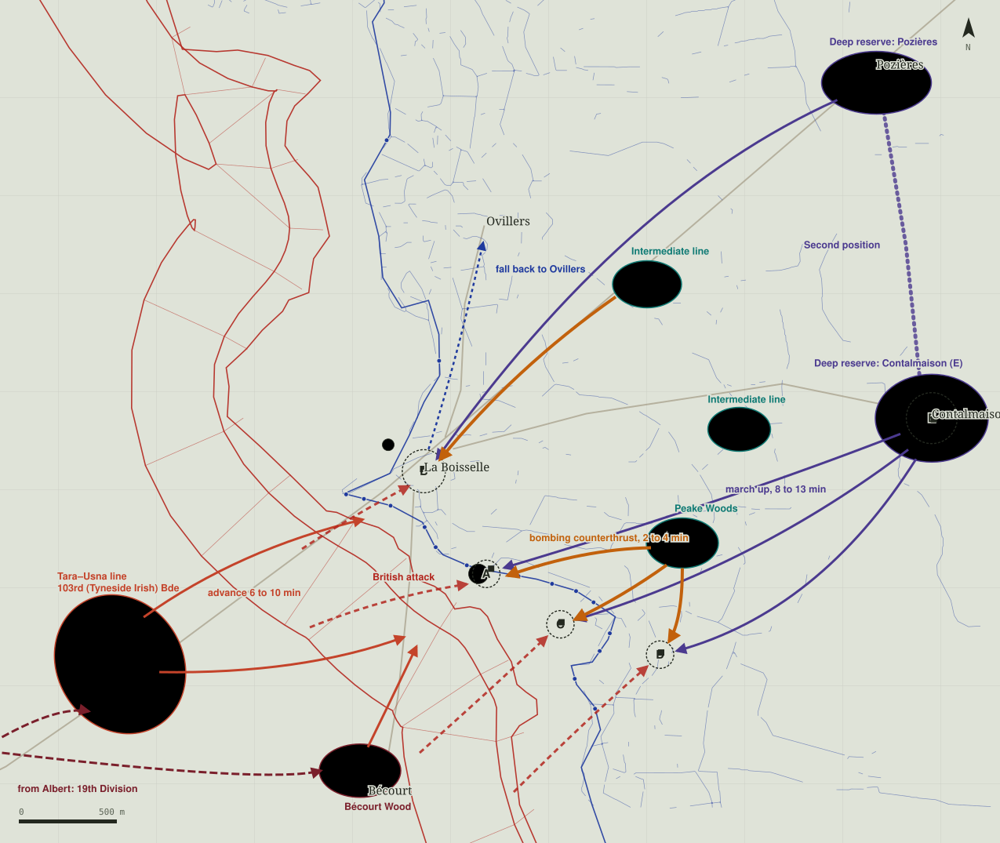

# Reserves: where the replacements come from

How men who fall on the front at La Boisselle (MAP-S02, 1 July 1916) are replaced in *They Fell*, on both sides. The game
follows the historical layout: neither army refilled its front trench out of thin air; each brought men up from behind,
from three depths, each slower and stronger than the last.

*True scale; one grid square is 500 m; north up. Trench lines, villages, objectives A–E, the Lochnagar crater, the
strongpoint dugouts and the German MG 08 posts are drawn from the game's own map data.*

## British (III Corps, 34th Division)

| Echelon | Where (game metres, x/z) | Who, historically | In the game |
|---|---|---|---|
| 1. Assault battalions | the British front and support trenches (the map's `spawns.BRI`) | 101st and 102nd (Tyneside Scottish) Brigades, the leading waves at 07:30 | the opening population, in waves 0–3 |
| 2. Tara–Usna line | Usna (1325, 3429), Tara (1600, 3847), astride the Albert–Bapaume road about a mile behind the front | 103rd (Tyneside Irish) Brigade, which advanced from here at zero hour across the open, under fire the whole way | part of the opening population starts here and advances at zero hour; afterwards most British men who fall come back here and walk up again (6–10 min to the front) |
| 3. Albert and Bécourt Wood | Bécourt Wood (2686, 4181); Albert, off the map's south-west edge, coming in on the road at (900, 4010) | 19th (Western) Division in corps reserve around Albert (it attacked La Boisselle on 2 July); brigade reserves in Bécourt Wood | from 08:30 a share of returning men come up from here, through the Tara–Usna line |

The dugouts at strongpoints the British have taken still send up two men a wave (they were German dugouts, used by
whoever holds them).

## German (28th Reserve Division, Reserve Infantry Regiment 110)

| Echelon | Where (game metres, x/z) | Who, historically | In the game |
|---|---|---|---|
| 1. Front garrison | the German fire trenches and deep dugouts; the machine guns | two battalions of RIR 110 in the first position; deep dugouts (*minierte Stollen*) 6–9 m down for about 25 men each | the opening population (the trench habits: pop-up, waiting, patrols, steady); the dugout at each strongpoint sends up two men a wave |
| 2. Immediate reserve (*Bereitschaft*) | the intermediate line about 1,000 yards back: Peake Woods (4330, 3020), in front of Contalmaison (4620, 2440), behind La Boisselle (4150, 1700) | RIR 110's third battalion in the intermediate line (*Stützpunktlinie*); a company of it counter-attacked from Peake Woods with bombs and machine guns against the Scots Redoubt, the 4th Company pushed the British back to the Lochnagar crater by midday | about 70 men at the start, sheltering; the hasty counter-attack force (at a run, 2–4 min to the front), and the first men of a deliberate counter-attack |
| 3. Deep reserve | the second position, Pozières (5320, 600) to Contalmaison (5602, 2383); off the east edge if the British hold Contalmaison | the second position, beyond British field-artillery range; RIR 110's commander ran the fight from Contalmaison; fresh formations (IR 190, the 3rd Guard Division) came up on 3–4 July | every German who falls comes back here, forms a section of 8–10 and marches up at the double to where HQ sends it (8–13 min for the 2–3 km, over the open, through the British barrage lifting onto the German rear); when the immediate reserve is under 40 men a section goes to make it up |

## The German HQ

A strategic layer, after Battlefield 1942's strategic AI (competing strategies, each scored every few seconds, each
handing out work to sections; the men still fight locally on their own senses). Every 5 seconds it looks at each
objective zone: how many British are within 400 m, how many Germans hold it, and whether it is still German.

Since 14 November 2026 the objectives are the three German lines, not strongpoints: the front line (A), a support line
(B) and a reserve line (C) behind it, each cut into stretches (A1–A5, B1–B4, C1–C4), and each stretch is a zone. A
stretch is taken by clearing it (British in it and not one German left, about 40 s), and only once the line in front is
wholly British; the Germans win one back the same way. Holding all three lines wins the battle. (The map below still
shows the old strongpoints A–E.)

- **Hold.** Keep each zone at its target strength, which rises with the threat. Sections go to fire-trench bays in the
  zone (and take up the trench habits) or to open posts round it, in shell holes facing the threat; men arriving at an
  unmanned machine gun take it.
- **Hasty counter-attack (*Gegenstoß*).** British inside a German zone or its trenches: the nearest immediate-reserve
  party (6–12) and the zone's survivors go in at once, bombing along the trenches.
- **Deliberate counter-attack (*Gegenangriff*).** An objective British for 3 minutes, and men to spare: up to 24 of the
  immediate reserve and sections from the rear (40 at most) gather 200 m off, the German guns shell the objective for about a minute, then they go in by rushes with bombs. If
  they retake it they settle into its trenches.
- **Withdraw.** A zone that is hopeless (the British several times stronger): its survivors fall back to the next
  German-held zone instead of dying in place, as RIR 110 was ordered back to Ovillers on 2 July.

## No overlapping

No two men stand in each other: new men are placed at least 0.7 m from anyone, and a separation pass pushes apart any
two closer than 0.6 m, men standing still included.

## Sources

- [Capture of La Boisselle](https://en.wikipedia.org/wiki/Capture_of_La_Boisselle) (dispositions of RIR 110, the dugouts, the counter-attacks from Peake Woods and to the Lochnagar crater, the withdrawal to Ovillers, IR 190 and the 3rd Guard Division)
- [103rd (Tyneside Irish) Brigade](https://en.wikipedia.org/wiki/103rd_(Tyneside_Irish)_Brigade) (the advance from the Tara–Usna line)
- [German Army on the Somme](https://warhistory.org/2019/09/21/german-army-on-the-somme/) (*Gegenstoß* and *Gegenangriff*; front, battle and rear zones)
- [Lochnagar Crater: the first day of the Somme](https://lochnagarcrater.org/history/first-day-of-somme/)
- [Battlefield Wiki: Conquest](https://battlefield.fandom.com/wiki/Conquest) and [DICE's Battlefield 1942 AI documentation](https://www.realtimerendering.com/erich/bf1942/mdt/MDTDOC/AI/Intro.htm) (control points as spawns; the strategic AI)
